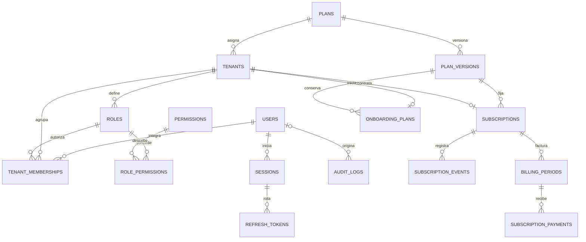

# Esquema inicial

En el comercio, `plan_versions` conserva condiciones de cada revisión. `subscriptions` enlaza cada restaurante con una versión y `subscription_events` conserva su historial. `billing_periods` identifica un período por suscripción y fecha inicial. `subscription_payments` controla reintentos por período y clave de solicitud. Las tablas `platform_settings`, `platform_assets`, `invitations`, `platform_notifications`, `notification_reads`, `support_tickets`, `support_events` y `backup_records` se incorporaron en `0003`. `0004` agrega `mail_jobs` y admite eventos de auditoría sin usuario identificado. `0005` fija la versión de incorporación de cada restaurante con una relación propia.

La revisión `0006` agrega configuración y perfiles locales, medios y carpetas, categorías, platillos, variantes, modificadores, historial de precios, áreas y mesas, clientes, métodos de pago y solicitudes de cambio. Sus relaciones usan tenant e identificador. La migración incorpora los nuevos permisos al rol Administrador existente y agrega un campo de cancelación a las invitaciones.

Los IDs son UUID en texto. La membresía referencia el rol por tenant e ID. La sesión referencia al usuario y opcionalmente a una membresía activa. Los importes comerciales iniciales se guardan en centavos y los eventos temporales en segundos Unix UTC.

## Operación de pedidos · Revisión 0007

- `orders`, `order_items`, `order_item_modifiers`, `order_discounts` y `order_status_history` guardan servicio, importes, referencias históricas y cambios.
- `kitchen_tickets` y `kitchen_ticket_items` registran documentos por estación y revisión. `kitchen_area_access` vincula un integrante con una estación de su restaurante.
- `order_accounts` y `order_account_items` conservan unidades asignadas al dividir una cuenta. Las claves compuestas impiden crear asignaciones entre pedidos.
- `document_sequences` mantiene correlativos por restaurante y tipo. `idempotency_records` conserva la huella y el resultado confirmados de una solicitud.
- El índice `uq_active_order_by_table` protege las mesas con pedidos operativos y estado financiero abierto. Los nuevos permisos se incorporan a roles predefinidos al migrar. Se conservan los permisos elegidos para roles personalizados.
